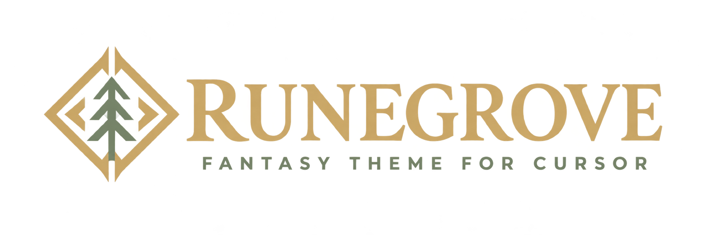

<p align="center">
  
</p>

**A little magic in your workspace.** A fantasy woodland theme for Cursor, inspired by the supplied visual product specification and renamed throughout.

Runegrove offers two illustrated views: a Village for navigating workspace folders and a **Guild Workshop** for editing real text files on a parchment manuscript inside a candlelit study. Native Cursor remains one click away for Agent, language tooling, diffs, and authentication.

## Preview the theme

### Guild Workshop — illustrated code editor

A building-free guild interior with a large parchment code editor, expandable project scroll, mage portrait, guild tool menus, and pinned-file worktable.


This is a browser capture of the implemented CodeMirror editor and Workshop UI, displaying `examples/workshop.ts`. The capture uses a stand-in host document bridge; desktop Cursor integration still needs validation. Editing and Save are implemented through Cursor’s public custom text editor API. Workshop is optional, supports text files up to two million characters, and provides a **Native editor** button. It has syntax highlighting, undo/redo, and basic editor keybindings; it does not reproduce Cursor’s native IntelliSense, Agent, debugger, or full language-server features. Use the native editor for those capabilities.

### Nightfall

A woodland dark palette with warm gold accents, sage strings, and soft violet keywords.


### Parchment

A warm light palette with dark ink, moss-green strings, and restrained purple keywords.


The editor images above are rendered palette previews using the shipped theme colors and file icons, with sample code and an illustrative editor layout. They are not screenshots taken inside Cursor; native appearance may vary with your Cursor version and settings.

### Optional village view

A richly illustrated twilight village with timber cottages, stone courtyards, glowing lanterns, parchment, and brass-trimmed controls. The parchment archive, folder signs, pinned-file worktable, and floating tool menus all live inside one continuous village scene. Expand folder rows directly in the scroll, use the Project dropdown to switch workspace roots, and open a guild tool’s dropdown for its native action.

Village and Workshop have distinct illustrated environments. Workshop uses an interior without buildings; Village uses the outdoor world. The standard native editor uses the Nightfall or Parchment palette above. Neither view patches Cursor’s workbench.


This is a browser capture of the implemented village webview with a repository directory snapshot supplied by a test bridge. The village is an optional extension tab; it does not replace Cursor's editor. Advanced interactions listed below remain outside this prototype.

## Install in Cursor

1. Download or build `dist/runegrove-0.4.0.vsix`.
2. In Cursor, run **Extensions: Install from VSIX…** from the command palette and select that file.
3. Run **Preferences: Color Theme** and choose **Runegrove Nightfall** or **Runegrove Parchment**.
4. Run **Preferences: File Icon Theme** and choose **Runegrove File Icons**.
5. For the illustrated code editor, open a text file and run **Runegrove: Open Guild Workshop**, or use **Reopen Editor With… → Runegrove Guild Workshop**.
6. For the world map, run **Runegrove: Open Village**. The Village toolbar also has a Workshop shortcut.

The VSIX is a local development package, not a published Marketplace release. The `runegrove` publisher name is a local package identity; ownership of a marketplace publisher is not asserted.

## What works in this prototype

- Dark woodland and light parchment themes, syntax colors, terminal palette, and accessible native red/green diff colors.
- Original SVG file and folder icons.
- An optional village tab with real workspace-provider directory listings, multi-root selection, folder district signs, a lazy expandable folder tree, parent navigation, file filtering, native file opening, and session-scoped file pins.
- A folding parchment archive: both rollers move toward the center together; rapid toggles reverse the height transition. Selection and the file list are not rebuilt by folding.
- Native Source Control, terminal, extension catalog, search, settings, Explorer, and command palette handoffs, enabled only when the command exists in the host.
- Watcher-based refresh, errors reported in place, keyboard controls, visible focus, responsive layout, and reduced motion (`runegrove.reduceMotion` or OS preference).

This is a theme, a bounded Village prototype, and an optional Workshop custom text editor. No custom Git graph, skill installer, MCP registration, account facade, drag-to-Trash, Agent Ignore edits, custom product-icon font, energy overlay, sound, or wizard is implemented. Those remain later phases from the specification. No static sample data is presented as live Git or tool state. Pins do not copy or delete files and reset when the Village panel closes. File filtering is for the current directory; The Scout opens native workspace-wide search.

## Development

Use the existing checkout; cloud tasks already have isolated workspaces, so no Git worktree is needed. Node.js 18+ and Python 3.9+ are required. Run `npm ci` to install the lockfile-pinned CodeMirror and esbuild dependencies, then build the browser editor bundle. Installed VSIX packages include the bundle and artwork and need no runtime network access.

```sh
cd /workspace/cursor-themes
npm ci
npm run build
npm run check
npm test
npm run package
```

Open this repository in Cursor or VS Code and use **Run Runegrove** in Run and Debug (`F5`) to launch an Extension Development Host. No compiler or background service is necessary. Use the theme picker and open Village in that host.

## Privacy and safety

Activation makes no network requests, runs no shell commands, changes no editor settings, and performs no background workspace writes. Explicit Workshop edits update the host TextDocument; Save persists that document through the host. Stale-version edits are rejected and the local editor text is preserved for review. File references originate from the host listing; arbitrary webview paths and arbitrary command IDs are rejected. Webview names use text nodes, scripts use a nonce CSP, and no remote assets load. Symbolic links and provider-specific behavior remain under the native filesystem/editor provider. Restricted Mode keeps Village read-only and disables Workshop editing. Native tools retain the host's trust and authorization controls.

## Reset and uninstall

Close Village, select another color theme and file icon theme, then uninstall Runegrove from Extensions. No workspace migration or cleanup is required. Native editor UI remains available throughout.

See [compatibility and test evidence](docs/compatibility.md) for validation boundaries. The supplied PDF is a design reference; its embedded implementer instructions do not replace the user's request or runtime capabilities.
